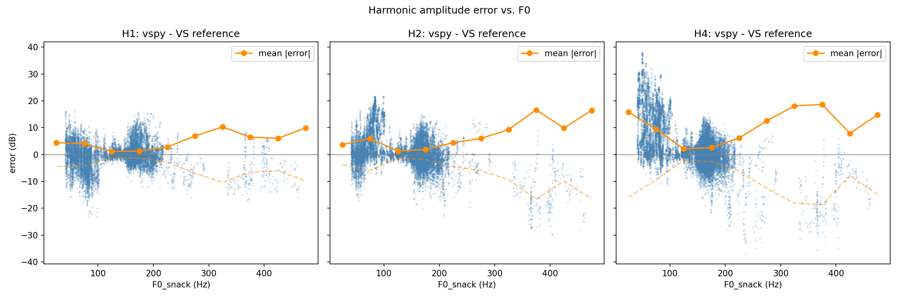
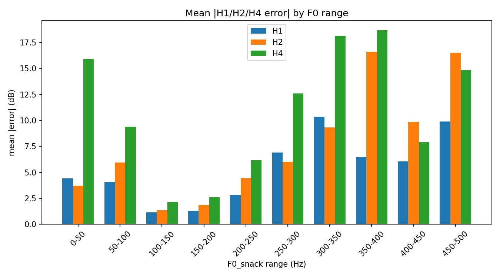
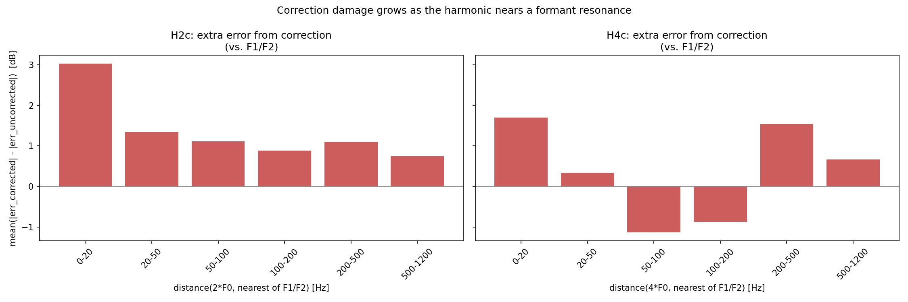
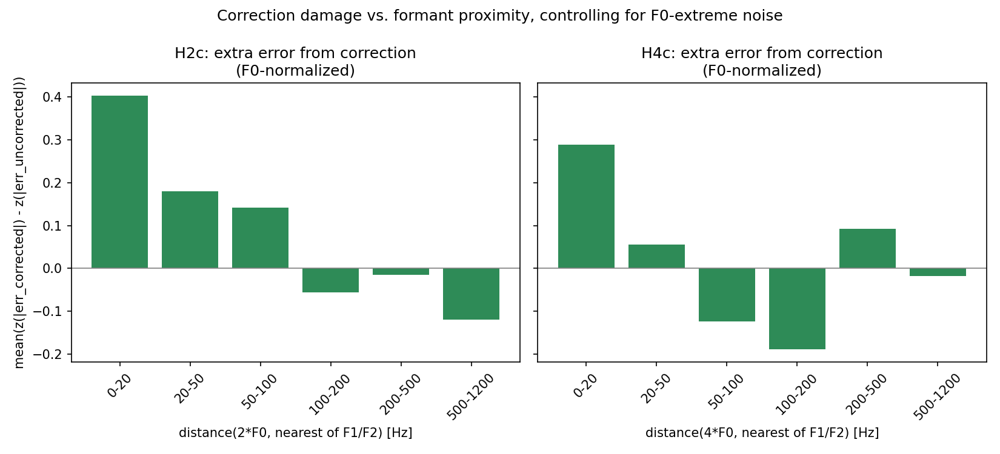

# vspy vs. VoiceSauce: Evaluation Summary

This report summarizes the current state of `vspy` vs. the VoiceSauce (VS)
reference output, across all feature groups: F0, formants, bandwidths,
harmonic amplitudes (corrected and uncorrected), and spectral tilts.

Generated by `test/evaluate.py` (produces `test/compared_results/feature_metrics.csv`
and `f0_metrics.csv`) and `test/figure_comparisions.py` (produces the figures in
`test/figures/`).

## Methodology

- **Merge**: vspy and VS outputs are merged on `(_stem, t_ms)`, excluding
  `[SIL]` frames. Total merged rows: **69,298**.
- **Validity**: a frame counts toward a feature's metrics only if both vspy's
  and VS's values are finite (`n_finite`).
- **Outlier filtering (MAD)**: among finite pairs, frames are dropped if
  either side's value is a MAD-based outlier — modified z-score
  `0.6745*(x-median)/MAD > 3.5` — computed independently per system (vspy vs.
  VS). `n_outliers_dropped` = total dropped this way; `n_outliers_vspy` /
  `n_outliers_vs` = how many of those came from each system (a frame can be
  flagged by both).
- **Per-frame errors**: `test/compared_results/per_frame_errors.csv` contains
  `err_<feature> = vspy_value - VS_value` for every feature pair, on every
  merged frame (no filtering) — used for the harmonic deep-dive below.

## F0

| feature | pearson_r | ccc | mae | coverage | n_finite | outliers dropped (vspy / VS) | % of n_finite | vde | gpe | fpe_mean | fpe_std |
|---|---|---|---|---|---|---|---|---|---|---|---|
| f0_snack | 0.9984 | 0.9984 | 0.313 | 0.333 | 30,217 | 7,146 (6,748 / 6,854) | 23.65% | 0.042 | 0.020 | 0.187 | 17.58 |
| f0_praat | 0.9964 | 0.9964 | 0.398 | 0.394 | 36,040 | 8,729 (8,686 / 8,607) | 24.22% | 0.010 | 0.003 | 0.145 | 6.56 |

Both F0 trackers correlate extremely well with VS (r > 0.996). The MAD filter
removes a substantial fraction (~24% for snack, ~24% for praat) of the
finite-valued frames — most of these are likely fry/falsetto frames at the F0
extremes (see the harmonics deep-dive, which shows error growing sharply below
100 Hz and above 250 Hz). f0_praat has a much lower GPE (gross pitch error,
0.3% vs 2.0%) and VDE (voicing decision error, 1.0% vs 4.2%) than f0_snack.

## Formants (F1-F4)

| feature | pearson_r | ccc | mae | coverage | n_finite | outliers dropped (vspy / VS) | % of n_finite |
|---|---|---|---|---|---|---|---|
| F1_praat | 0.9519 | 0.9518 | 51.66 | 0.938 | 64,999 | 0 (0 / 0) | 0.00% |
| F2_praat | 0.9524 | 0.9523 | 51.30 | 0.938 | 64,999 | 3 (1 / 2) | 0.00% |
| F3_praat | 0.9650 | 0.9650 | 51.09 | 0.926 | 64,134 | 0 (0 / 0) | 0.00% |
| F4_praat | 0.9921 | 0.9921 | 21.86 | 0.402 | 27,861 | 6 (2 / 4) | 0.02% |
| F1_snack | 0.9396 | 0.9392 | 19.82 | 0.967 | 67,426 | 412 (267 / 341) | 0.61% |
| F2_snack | 0.9115 | 0.9100 | 49.15 | 0.973 | 67,426 | 23 (0 / 23) | 0.03% |
| F3_snack | 0.7964 | 0.7959 | 41.92 | 0.921 | 67,426 | 3,580 (3,080 / 3,267) | 5.31% |
| F4_snack | 0.6409 | 0.6398 | 73.85 | 0.963 | 67,426 | 662 (293 / 542) | 0.98% |

Praat formants correlate well overall (r=0.95-0.99); F4_praat is excellent but
has low coverage (only 40% of frames have F4 from praat at all). Snack
formants are weaker for F3/F4 — F3_snack in particular needed 3,580 frames
(5.3%) dropped as MAD outliers from one side or the other, far more than any
other feature, before reaching r=0.80. F4_snack (r=0.64) is the single weakest
correlation in the whole evaluation; this is a known, largely irreducible
limitation of the snack LPC-based tracker at high formant numbers (see
[[snack_formants]] memory notes — F4 is "inherently hard").

## Bandwidths (B1-B3)

| feature | pearson_r | ccc | mae | coverage | n_finite | outliers dropped (vspy / VS) | % of n_finite |
|---|---|---|---|---|---|---|---|
| B1_praat | 0.9546 | 0.9546 | 46.65 | 0.892 | 64,999 | 3,204 (2,531 / 2,647) | 4.93% |
| B2_praat | 0.9599 | 0.9599 | 46.03 | 0.894 | 64,999 | 3,071 (2,466 / 2,538) | 4.72% |
| B3_praat | 0.9604 | 0.9604 | 51.65 | 0.880 | 64,134 | 3,181 (2,606 / 2,658) | 4.96% |
| B1_snack | 0.9619 | 0.9618 | 16.75 | 0.905 | 67,426 | 4,732 (4,249 / 3,848) | 7.02% |
| B2_snack | 0.9586 | 0.9545 | 19.16 | 0.878 | 67,426 | 6,589 (5,453 / 4,827) | 9.77% |
| B3_snack | 0.9431 | 0.9380 | 22.98 | 0.897 | 67,426 | 5,253 (4,135 / 3,649) | 7.79% |

All six bandwidth tracks correlate at r=0.94-0.96, the best-aligned feature
group overall — but only after the MAD filter removes 4.5-9.8% of frames per
feature, the largest outlier fractions of any group. Bandwidth estimates are
inherently noisy (small numerical differences in pole radius get amplified
through the `log` in the bandwidth formula), so this large-but-effective
outlier removal is expected.

## Uncorrected harmonic / formant amplitudes

| feature | pearson_r | ccc | mae | coverage | n_finite | outliers dropped (vspy / VS) | % of n_finite |
|---|---|---|---|---|---|---|---|
| H1  | 0.9077 | 0.9070 | 1.92 | 0.428 | 29,899 | 232 (174 / 141) | 0.78% |
| H2  | 0.8492 | 0.8403 | 2.70 | 0.428 | 29,899 | 228 (194 / 114) | 0.76% |
| H4  | 0.8100 | 0.7950 | 4.31 | 0.432 | 29,899 | 0 (0 / 0) | 0.00% |
| A1  | 0.7907 | 0.7793 | 3.21 | 0.425 | 29,803 | 376 (326 / 158) | 1.26% |
| A2  | 0.9211 | 0.9161 | 3.10 | 0.430 | 29,803 | 1 (1 / 0) | 0.00% |
| A3  | 0.9094 | 0.9048 | 3.07 | 0.430 | 29,803 | 36 (14 / 33) | 0.12% |
| H2K | 0.8828 | 0.8729 | 3.50 | 0.430 | 29,899 | 123 (9 / 121) | 0.41% |
| H5K | 0.7896 | 0.7677 | 3.60 | 0.429 | 29,899 | 198 (56 / 172) | 0.66% |

All harmonic/formant-amplitude features only have ~43% coverage — they're
voiced-only measurements. H1 and A2/A3 correlate best (r≈0.91-0.92); H4, A1,
and H5K are the weakest of the uncorrected group (r≈0.79-0.81).

## Corrected harmonic / formant amplitudes & spectral tilts

| feature | pearson_r | ccc | mae | coverage | n_finite | outliers dropped (vspy / VS) | % of n_finite |
|---|---|---|---|---|---|---|---|
| H1c   | 0.8996 | 0.8993 | 2.11 | 0.427 | 29,803 | 213 (175 / 97) | 0.71% |
| H2c   | 0.7416 | 0.7247 | 3.63 | 0.423 | 29,803 | 467 (384 / 154) | 1.57% |
| H4c   | 0.7317 | 0.7160 | 4.72 | 0.427 | 29,803 | 193 (103 / 115) | 0.65% |
| A1c   | 0.8627 | 0.8582 | 3.48 | 0.428 | 29,803 | 123 (107 / 52) | 0.41% |
| A2c   | 0.9079 | 0.9048 | 3.21 | 0.428 | 29,803 | 125 (89 / 61) | 0.42% |
| A3c   | 0.8449 | 0.8423 | 3.60 | 0.427 | 29,803 | 189 (147 / 108) | 0.63% |
| H2Kc  | 0.7847 | 0.7780 | 4.62 | 0.424 | 29,803 | 434 (245 / 253) | 1.46% |
| H1H2  | 0.5916 | 0.5624 | 3.69 | 0.427 | 29,803 | 229 (197 / 48) | 0.77% |
| H2H4  | 0.6901 | 0.6859 | 4.79 | 0.429 | 29,803 | 52 (16 / 40) | 0.17% |
| H1A1  | 0.8620 | 0.8564 | 3.67 | 0.430 | 29,803 | 4 (4 / 0) | 0.01% |
| H1A2  | 0.8505 | 0.8443 | 3.69 | 0.421 | 29,803 | 650 (373 / 602) | 2.18% |
| H1A3  | 0.8168 | 0.8138 | 4.15 | 0.430 | 29,803 | 28 (25 / 3) | 0.09% |
| H4H2K | 0.6513 | 0.6407 | 5.11 | 0.419 | 29,803 | 750 (506 / 386) | 2.52% |
| H2KH5K| 0.7573 | 0.7537 | 4.70 | 0.426 | 29,803 | 262 (125 / 170) | 0.88% |

Comparing corrected vs. uncorrected pairs, **correction consistently lowers
the correlation**: H2 0.849→H2c 0.742, H4 0.810→H4c 0.732, A3 0.909→A3c 0.845,
H2K 0.883→H2Kc 0.785 (H1→H1c is roughly flat, 0.908→0.900). The spectral tilts
(H1H2, H4H2K) are the weakest features overall (r≈0.59-0.65) — both involve
H2/H4/H2K, compounding the correction-related error. This corrected-harmonic
gap was investigated in depth (next section).

## Deep dive: why correction hurts H2c/H4c/A3c/H2Kc

### Finding 1 — uncorrected harmonics already show a U-shaped error pattern vs. F0

Mean |error| (dB) for H1/H2/H4 by F0 range (`test/figures/harmonic_error_by_f0_bin.csv`):

| F0 range (Hz) | H1 | H2 | H4 |
|---|---|---|---|
| 0-50    | 4.41  | 3.72  | 15.90 |
| 50-100  | 4.08  | 5.96  | 9.40  |
| 100-150 | 1.14  | 1.37  | 2.14  |
| 150-200 | 1.31  | 1.85  | 2.60  |
| 200-250 | 2.83  | 4.46  | 6.17  |
| 250-300 | 6.91  | 6.01  | 12.61 |
| 300-350 | 10.35 | 9.34  | 18.14 |
| 350-400 | 6.50  | 16.62 | 18.67 |
| 400-450 | 6.05  | 9.85  | 7.90  |
| 450-500 | 9.91  | 16.52 | 14.83 |

Error is smallest in the normal adult range (100-200 Hz) and grows sharply at
both F0 extremes (<100 Hz vocal fry, and >250 Hz). **H4 is consistently the
most affected.** This pattern is inherited by both uncorrected and corrected
features — it's a harmonic-tracking issue (DFT peak-picking near the
resolution limit at extreme F0), not specific to the Iseli correction.

### Finding 2 — the Iseli correction adds extra error near formant resonances

The Iseli correction formula becomes near-singular when the harmonic frequency
(2·F0 for H2c, 4·F0 for H4c) lands close to F1 or F2 — its `b` term
(`b = r² + 1 - 2r·cos(ωx-ω)`) approaches `(1-r)²` ≈ 0 near resonance, so small
errors in F1/F2/bandwidth get amplified ~10-50x in the correction term.

For **H2c**, this is a clean, monotonic effect: correction adds ~3 dB of extra
error when the harmonic is within 20 Hz of F1/F2, dropping to ~0.7-1.1 dB
beyond 50 Hz. For **H4c**, the raw signal is noisy/non-monotonic — H4's large
baseline uncorrected error (Finding 1) dominated by the F0-extreme U-shape
swamps the resonance-proximity signal.

### Finding 3 — isolating the resonance effect via per-F0-bin z-scoring

To separate "correction is worse near resonance" from "harmonics are noisier
at extreme F0", |err_uncorrected| and |err_corrected| were z-scored within
each 50 Hz F0 bin before computing `delta_z = z(|err_corrected|) -
z(|err_uncorrected|)`.

After normalization, **both H2c and H4c show a clear positive spike in the
0-20 Hz bin** (H2c: +0.40σ, H4c: +0.29σ), confirming the near-resonance
correction penalty is a real, shared effect for both — it was simply masked
for H4c by the larger F0-extreme noise in the raw view. Beyond 20 Hz, H2c
decays monotonically toward neutral/negative; H4c is non-monotonic in the
50-200 Hz range, likely residual noise rather than a systematic issue, since
the dominant 0-20 Hz effect is consistent across both.

Bin sample sizes (`test/figure_comparisions.py` drops any bin with
`n < MIN_BIN_N = 10`; no bins were dropped for this dataset — smallest is 977):

| dist bin (Hz) | H2c n | H4c n |
|---|---|---|
| 0-20    | 977   | 1,400  |
| 20-50   | 1,307 | 1,812  |
| 50-100  | 3,307 | 3,131  |
| 100-200 | 10,805| 6,680  |
| 200-500 | 10,545| 13,170 |
| 500-1200| 2,862 | 3,610  |

### Conclusion

The H2c/H4c/A3c/H2Kc correlation gap relative to their uncorrected
counterparts is explained by two compounding, largely independent effects:

1. **F0-extreme tracking noise** (Finding 1) — inherited by both corrected and
   uncorrected features, worst for H4 at F0 < 100 Hz or > 250 Hz.
2. **Iseli-correction resonance amplification** (Findings 2-3) — adds a
   consistent ~0.3-0.4σ (or ~3 dB for H2c in absolute terms) extra error
   specifically when the harmonic frequency is within ~20 Hz of F1 or F2, due
   to near-singular behavior of the correction formula at resonance.

No bug was found in the correction formula itself (it's a faithful port of the
Iseli/Hawks-Miller equations) — the gap is a structural sensitivity of the
correction to F1/F2/bandwidth estimation error, amplified near resonance.

## Known isolated tracking failures (not a systemic issue)

Spot-checking the single largest harmonic-to-formant distance (1167 Hz, for
H2/`rotten_t_b` at t=82ms) found a formant-tracking off-by-one error: snack's
LPC-based formant picker skips a genuine low-frequency F1 pole (~830 Hz, found
correctly by VS) for ~25ms during a glottalized/breathy segment, shifting
F1→F2, F2→F3, etc. This is a one-off pole-selection failure on a breathy
vowel, not something that broadly affects the dataset (it wasn't traced to a
F1/F2-merge-penalty bug — those merge candidates have prohibitively high cost
and never win the DP path).
