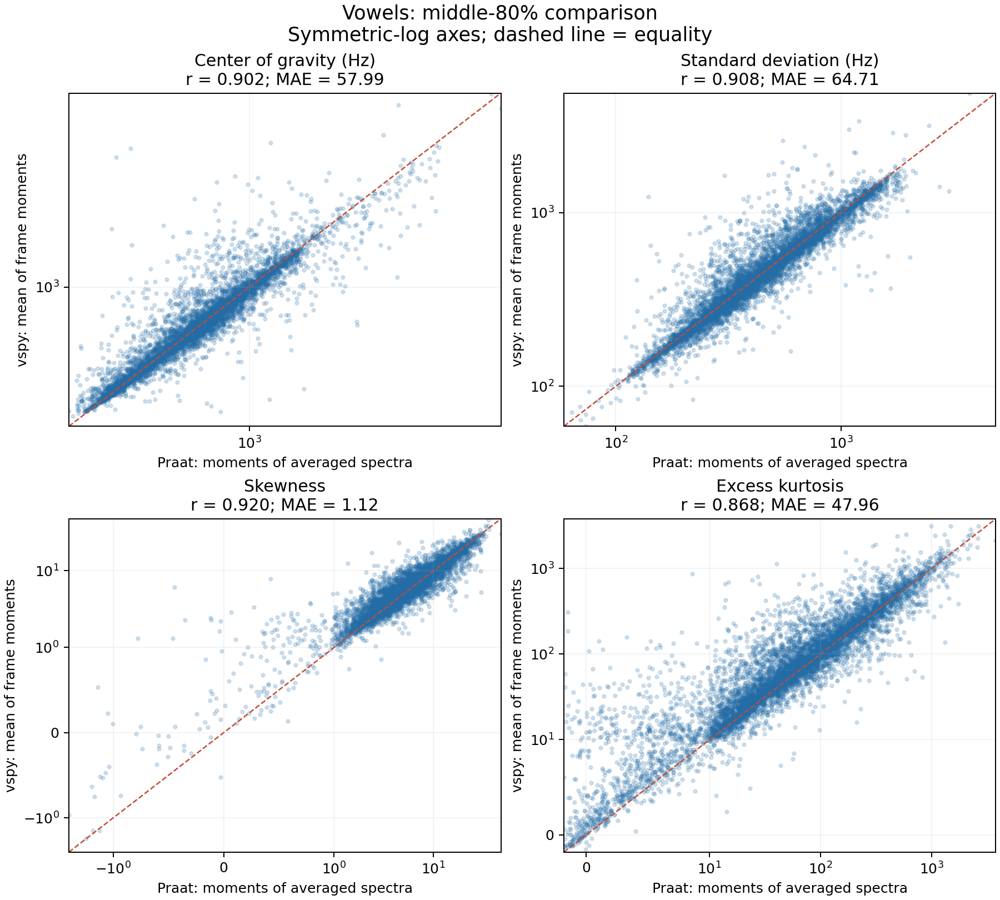

# Vowel spectral moments comparison

Compared 7482 vowel intervals from 3716 audio files. Selection:
nonempty intervals on explicitly named vowel/vowels tiers in test/textgrid and
test/sanity test; labels marked bad or silence are excluded. Generic segment
tiers are not guessed to contain vowels. Original labels are preserved in the
comparison CSV. Labels on vowel tiers are treated as vowel annotations even
when they describe phonation rather than vowel identity.

The original Praat script was executed unchanged through Parselmouth. Temporary
TextGrid copies relabel selected intervals to `vowel`, allowing the original
script's exact-label selection to process them together. Original TextGrids
are unchanged. Form arguments use the annotated tier and original sample rate
(no upsampling). Defaults retained: six 15 ms windows, 300 Hz cutoff, middle
80% of each interval. This runs the script's fricative-oriented settings on
vowels as requested; it does not establish that those settings suit every
vowel-analysis research question.

vspy's registered spectral_moments extractor ran at a 1 ms hop on the original
audio. Arithmetic means of valid frame moments were calculated separately for
frame centers in [start, end) and in the middle 80% of each interval. NaNs are
excluded; frame counts are in segment_comparison.csv. Frames are computed on
the continuous recording, so windows near segment boundaries may cross them.

84 intervals violate the original
script's recommendation that six window lengths total no more than 1.6 times
the segment duration; these are flagged and retained. 8 read/run
or annotation issues are recorded in errors.json.

## Results

Bias means vspy minus Praat. COG and SD errors are in Hz; skew and excess
kurtosis are dimensionless. Correlations are across segments.

| Dataset | Averaging region | Moment | N | Bias | MAE | RMSE | Pearson r |
|---|---|---|---:|---:|---:|---:|---:|
| all | full | cog | 7479 | 23.0296 | 83.2713 | 163.6037 | 0.8660 |
| all | full | sdev | 7479 | 37.7963 | 88.1401 | 165.6738 | 0.8726 |
| all | full | skew | 7479 | 0.3996 | 1.2943 | 2.0851 | 0.9132 |
| all | full | kurt | 7479 | 24.4157 | 54.4582 | 121.5669 | 0.8592 |
| all | middle80 | cog | 7479 | 8.5407 | 57.9890 | 139.7363 | 0.9016 |
| all | middle80 | sdev | 7479 | 10.3704 | 64.7118 | 136.3525 | 0.9081 |
| all | middle80 | skew | 7479 | 0.2443 | 1.1223 | 2.0060 | 0.9197 |
| all | middle80 | kurt | 7479 | 19.3244 | 47.9574 | 121.4392 | 0.8682 |
| corpus | full | cog | 7474 | 23.0551 | 83.2826 | 163.6443 | 0.8660 |
| corpus | full | sdev | 7474 | 37.7927 | 88.1703 | 165.7226 | 0.8726 |
| corpus | full | skew | 7474 | 0.3996 | 1.2947 | 2.0857 | 0.9132 |
| corpus | full | kurt | 7474 | 24.4223 | 54.4795 | 121.6052 | 0.8592 |
| corpus | middle80 | cog | 7474 | 8.5432 | 57.9907 | 139.7699 | 0.9016 |
| corpus | middle80 | sdev | 7474 | 10.3532 | 64.7306 | 136.3903 | 0.9081 |
| corpus | middle80 | skew | 7474 | 0.2443 | 1.1227 | 2.0066 | 0.9197 |
| corpus | middle80 | kurt | 7474 | 19.3337 | 47.9791 | 121.4789 | 0.8682 |
| sanity | full | cog | 5 | -15.0918 | 66.4295 | 83.1595 | 0.4891 |
| sanity | full | sdev | 5 | 43.0595 | 43.0595 | 57.1490 | 0.9641 |
| sanity | full | skew | 5 | 0.5094 | 0.7436 | 0.9357 | 0.8548 |
| sanity | full | kurt | 5 | 14.5494 | 22.6266 | 29.2829 | 0.7682 |
| sanity | middle80 | cog | 5 | 4.8195 | 55.3731 | 73.9005 | 0.5873 |
| sanity | middle80 | sdev | 5 | 36.0624 | 36.6337 | 56.1914 | 0.9439 |
| sanity | middle80 | skew | 5 | 0.2115 | 0.5277 | 0.6599 | 0.9118 |
| sanity | middle80 | kurt | 5 | 5.3231 | 15.5799 | 17.7153 | 0.8395 |

## Interpretation and reproduction

This compares two aggregation methods, not numerical equivalence. Praat
averages unnormalized power spectra from six windows, then computes moments.
vspy computes normalized moments every millisecond, then averages each moment
equally across frames. These operations generally differ, particularly for
variance, skewness, and kurtosis, and for time-varying intensity. The script
also filters the extracted interval before windowing, uses a 0.1 ms window
extension and one-based cutoff-bin selection; vspy excludes bins below 300 Hz
on a 15 ms NumPy Hann spectrum. These implementation differences are retained.

Run `python -m test.compare_spectral_moments` from the repository root (or add
`--sanity-only` for just the three sanity recordings). Raw Praat logs are in
praat_raw/, compressed vspy frame CSVs in frames/, paired interval results in
segment_comparison.csv, and aggregate results in metrics.csv. Standalone
segment tables are praat_segments.csv and vspy_segment_means.csv. Use --resume
only when the input audio, annotations, script, and extraction settings are
unchanged; it reuses previously saved raw logs and frames.

Three very short intervals have no valid vspy frames; 7,479 intervals enter each metric. Seven annotation files have unusable or ambiguously paired objects, and one zero-duration interval is excluded (see errors.json).

Saved results were independently checked against raw Praat logs and recomputed frame means for 59 intervals across 33 recordings, including all sanity recordings. See validation.json.

Recreate the plot with `python -m test.plot_spectral_moments` (requires matplotlib).
